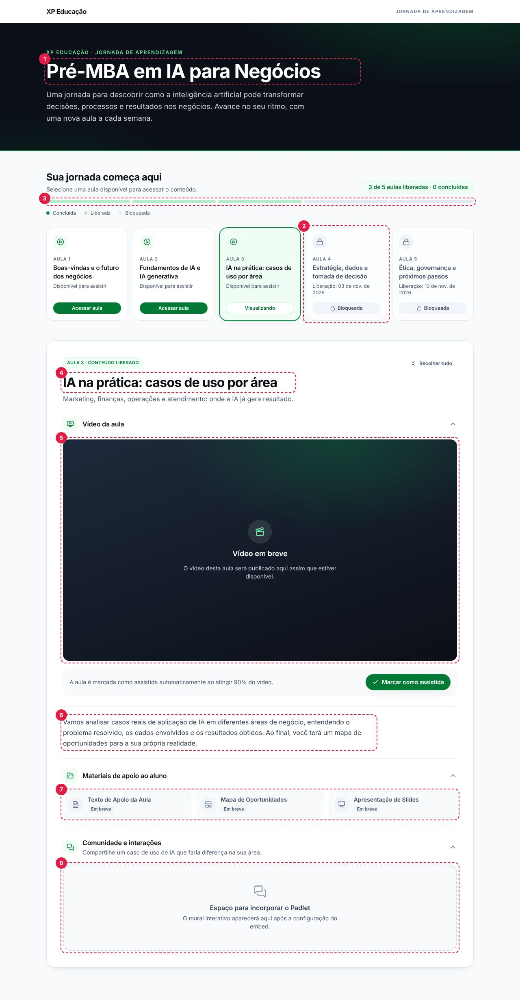

# Pré-MBA em IA para Negócios · XP Educação

Página única (one-page) da jornada **Pré-MBA em IA para Negócios**, com 5 aulas liberadas semanalmente. É aberta dentro do Brightspace (D2L) por link ou iframe e hospedada no **GitHub Pages** (100% estático).



> **Atualizações semanais/mensais (datas, títulos, vídeos, links, materiais, Padlet) são feitas editando um único arquivo: [`src/content/course.json`](src/content/course.json).** Veja o [Guia de conteúdo](docs/CONTENT_GUIDE.md).

## Stack

Vite · React 19 · TypeScript (strict) · Tailwind CSS v4 · shadcn/ui (Button, Badge, Skeleton) · lucide-react · Zod · Vitest.

## Como rodar

Requisitos: Node.js 22 (veja `.nvmrc`) e npm.

```bash
npm ci
npm run dev
```

Abra `http://localhost:5173`. Para simular outra data, use `?today=` (ativo em desenvolvimento):

- `http://localhost:5173/?today=2026-10-27` → aulas 1, 2 e 3 liberadas; 4 e 5 bloqueadas;
- `http://localhost:5173/?today=2026-10-19T23:59:50-03:00` → em 10 segundos, a aula 2 é liberada na sua frente, sem recarregar.

| Script            | O que faz                                                      |
| ----------------- | -------------------------------------------------------------- |
| `npm run dev`     | Servidor local com recarga automática                          |
| `npm run build`   | Checa tipos, **valida o `course.json`** e gera `dist/`         |
| `npm run preview` | Serve o `dist/` localmente                                     |
| `npm test`        | Testes (Vitest)                                                |
| `npm run lint`    | ESLint (inclui as regras de arquitetura)                       |
| `npm run format`  | Formata o código com Prettier                                  |
| `npm run check`   | Tipos + lint + formatação + testes (rode antes de abrir um PR) |

## Deploy (GitHub Pages)

1. No repositório: **Settings › Pages › Build and deployment › Source: GitHub Actions**.
2. Faça push na `main`. O workflow [`.github/workflows/deploy.yml`](.github/workflows/deploy.yml) roda checagens, testes e build e publica em `https://<usuario>.github.io/<repo>/`.
3. O caminho base (`/<repo>/`) é configurado automaticamente. Para builds manuais, use `VITE_BASE_PATH=/<repo>/ npm run build`.

Se o `course.json` estiver inválido, **o build falha e o site continua com a versão anterior** (nada quebrado chega aos alunos). A mensagem de erro aponta a aula e o campo.

### Incorporar no Brightspace (D2L)

Use um tópico do tipo link (abrir em nova janela) ou um arquivo HTML com iframe:

```html
<iframe
  src="https://<usuario>.github.io/<repo>/"
  title="Pré-MBA em IA para Negócios"
  style="width: 100%; height: 1400px; border: 0"
  allow="autoplay; encrypted-media; picture-in-picture; fullscreen; clipboard-write"
  allowfullscreen
></iframe>
```

O atributo `allow` é necessário para o vídeo tocar após o clique e abrir em tela cheia dentro do iframe.

## Variáveis de ambiente

Todas são opcionais (veja [`.env.example`](.env.example)).

| Variável                   | Padrão                         | Uso                                                |
| -------------------------- | ------------------------------ | -------------------------------------------------- |
| `VITE_BASE_PATH`           | `/`                            | Caminho de publicação (`/<repo>/` no GitHub Pages) |
| `VITE_ACCESS_PROVIDER`     | `static`                       | `static` (fase 1) ou `api` (fase 2, FastAPI)       |
| `VITE_ACCESS_API_BASE_URL` | vazio                          | URL da API de acesso (somente com `api`)           |
| `VITE_ALLOW_DATE_OVERRIDE` | `true` em dev, `false` em prod | Habilita o simulador `?today=`                     |

## Onde mexer

| Quero mudar…                                        | Arquivo                                    |
| --------------------------------------------------- | ------------------------------------------ |
| Datas, títulos, vídeos, materiais, Padlet           | `src/content/course.json`                  |
| Textos fixos da interface (botões, rótulos, avisos) | `src/content/ui-text.ts`                   |
| Cores, sombras (design tokens)                      | `src/styles/tokens.css`                    |
| Ícones disponíveis para materiais                   | `src/lib/material-icons.ts`                |
| Regras de liberação e progresso                     | `src/domain/` (funções puras, com testes)  |
| Integração com a API (fase 2)                       | `src/services/access/ApiAccessProvider.ts` |

## Aviso importante: liberação por data é só experiência de uso

Nesta fase, o bloqueio das aulas é **visual (UX)**. Todo o conteúdo do `course.json` (incluindo links de vídeos e materiais de aulas futuras) é público: fica no repositório e no JavaScript publicado. **Não coloque links que não possam ser vistos antes da data.** Bloqueio real só virá com o backend ([roadmap da API](docs/API_ROADMAP.md)).

Privacidade (LGPD): a página não coleta dados pessoais. O progresso fica apenas no navegador do aluno (`localStorage`, chave `xp-premba:v1:progress`) e os vídeos do YouTube usam o domínio `youtube-nocookie.com`.

## Documentação

- [Guia de conteúdo](docs/CONTENT_GUIDE.md): adicionar aula, trocar datas, links, vídeos e Padlet
- [Arquitetura](docs/ARCHITECTURE.md): camadas, fluxo de dados e decisões
- [Roadmap da API (fase 2)](docs/API_ROADMAP.md): contrato e checklist de migração
- [Como contribuir](CONTRIBUTING.md): convenções, commits, componentes e testes
