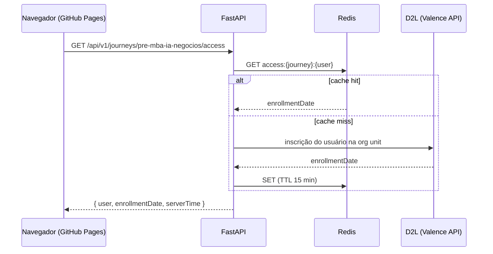

# Roadmap da API (fase 2)

Na fase 2, um backend **FastAPI** com cache **Redis** informa a data de inscrição do aluno no D2L. A liberação passa a ser "data de inscrição + N dias" (ex.: inscrito em 13/10 com `days: 10` → aula liberada em 23/10, à 00:00 de São Paulo).

O front-end já está pronto para isso: `EnrollmentOffsetStrategy` e testes em `domain/`, o tipo `enrollment_offset` no schema e o stub `ApiAccessProvider`.

## Contrato

```http
GET /api/v1/journeys/{journeyId}/access
```

Resposta `200 OK`:

```json
{
  "user": { "id": "d2l-12345", "displayName": "Aluno A" },
  "enrollmentDate": "2026-10-13T15:30:00-03:00",
  "serverTime": "2026-10-20T09:12:45-03:00"
}
```

| Campo              | Tipo     | Observação                                                                |
| ------------------ | -------- | ------------------------------------------------------------------------- |
| `user.id`          | string   | Identificador do aluno no D2L (sem CPF ou e-mail: minimização, LGPD)      |
| `user.displayName` | string   | Opcional para a UI; pode ser vazio                                        |
| `enrollmentDate`   | ISO-8601 | Com fuso. Data de inscrição na oferta (org unit) correspondente à jornada |
| `serverTime`       | ISO-8601 | "Agora" oficial. Evita que um relógio errado no computador libere aulas   |

Erros esperados: `401` (sessão ausente/expirada), `403` (aluno sem inscrição na jornada), `404` (jornada desconhecida), `5xx`. A UI mostra o estado "Não foi possível verificar o seu acesso" com o botão **Tentar novamente**.

### Backend (orientações)

- **Autenticação**: a definir com o time do LMS (LTI 1.3 launch ou token assinado repassado pelo D2L). Nunca confiar em `userId` vindo da URL.
- **Cache Redis no servidor**: chave `access:{journeyId}:{userId}`, TTL sugerido de 15 minutos; a data de inscrição muda raramente.
- **CORS**: permitir apenas a origem do GitHub Pages (`https://<usuario>.github.io`), com `credentials` se houver cookie.
- **Cabeçalhos**: `Cache-Control: no-store` na resposta ao navegador (o cache é do backend).



## Checklist de migração

1. **Implementar `ApiAccessProvider`** (`src/services/access/ApiAccessProvider.ts`), seguindo o checklist no próprio arquivo:
   - `fetch` com timeout (`AbortController`) e `credentials: 'include'`;
   - validar a resposta com Zod (`AccessApiResponse`);
   - memorizar a primeira resposta (uma requisição por carregamento);
   - calcular `now` a partir de `serverTime` com `createShiftedClock`;
   - adicionar testes com `fetch` simulado (sucesso, 401, payload inválido, timeout).
2. **Configurar o build**: `VITE_ACCESS_PROVIDER=api` e `VITE_ACCESS_API_BASE_URL=https://api.exemplo.com` no `deploy.yml`.
3. **Trocar as aulas no JSON**: `{ "type": "fixed_date", "date": ... }` → `{ "type": "enrollment_offset", "days": N }`.
4. Validar com um aluno de teste em homologação (inscrição recente e antiga).

Recomendado na mesma entrega:

- Separar o progresso por aluno (incluir `userId` na chave do `ProgressRepository`) caso o mesmo navegador seja compartilhado.
- Decidir o comportamento do simulador `?today=` com a API (sugestão: continuar desligado em produção).

## Segurança: o que a fase 2 resolve (e o que não)

A fase 2 calcula a liberação com dados confiáveis, mas **os links continuam públicos** enquanto estiverem no `course.json`. Para bloqueio real, a API também deve entregar as URLs de vídeo e materiais **somente das aulas liberadas** (ex.: `GET /api/v1/journeys/{id}/lessons/{lessonId}/content`), e o `course.json` passa a guardar apenas metadados.
