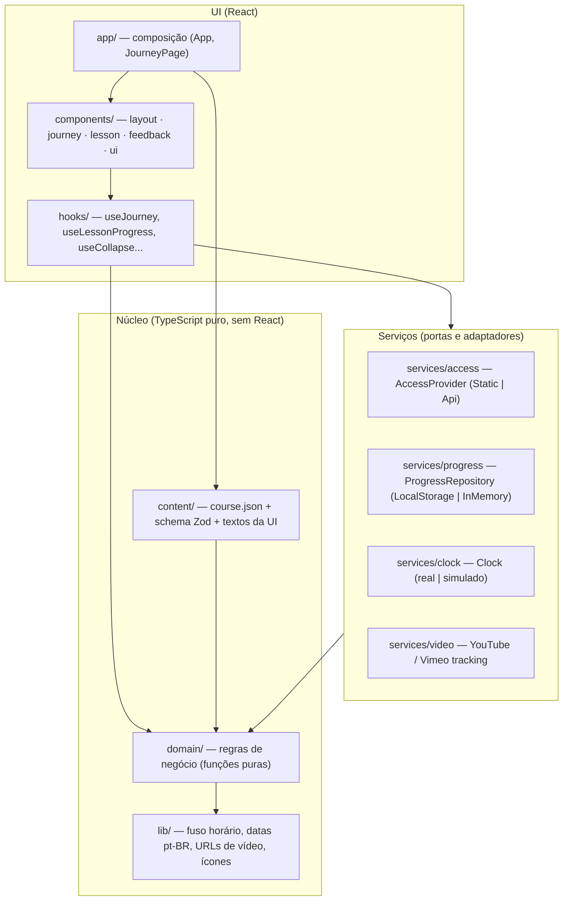
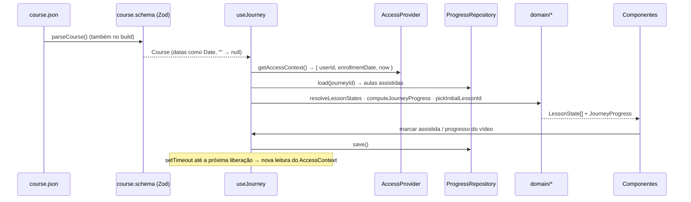

# Arquitetura

Objetivo: qualquer pessoa encontra rapidamente **onde mexer**, e uma mudança em uma camada não exige mexer nas outras.

## Camadas

Regra de dependência: **as setas só descem**. `domain/` não conhece React, storage nem rede; por isso é 100% testável com um `Clock` injetado.

| Pasta             | Responsabilidade                                                                                          |
| ----------------- | --------------------------------------------------------------------------------------------------------- |
| `src/content/`    | `course.json` (conteúdo), `course.schema.ts` (validação + normalização), `ui-text.ts` (textos fixos)      |
| `src/domain/`     | Tipos e regras: estratégias de liberação, status da aula, progresso, seleção inicial, conclusão por vídeo |
| `src/services/`   | Tudo que toca o "mundo externo": relógio, storage, API, players de vídeo                                  |
| `src/hooks/`      | Orquestração de estado React (sem regra de negócio)                                                       |
| `src/components/` | Apresentação. Recebem dados prontos por props; textos vêm de `ui-text.ts`                                 |
| `src/app/`        | Raiz de composição: lê a configuração, cria os serviços e monta a página                                  |
| `src/styles/`     | `tokens.css` (único lugar com cores) e `index.css` (mapa Tailwind + utilitários)                          |

## Fluxo de dados

## Decisões principais

- **Strategy para liberação** (`domain/release-strategies.ts`): `FixedDateStrategy` e `EnrollmentOffsetStrategy`. Nova regra = nova classe + novo tipo no schema; nada muda na UI.
- **Portas e adaptadores**: `AccessProvider`, `ProgressRepository` e `Clock` são interfaces. A troca da fase 1 para a 2 é `VITE_ACCESS_PROVIDER=api`, resolvida em um único lugar (`app/create-app-services.ts`).
- **Fuso horário explícito**: datas de liberação são convertidas com `Intl` no fuso da jornada (`lib/timezone.ts`), nunca no fuso do navegador.
- **Conteúdo validado duas vezes**: no build (plugin `scripts/vite-plugin-course-content.ts` falha o deploy) e em runtime (tela de erro amigável com o campo exato).
- **Atualização automática**: um único `setTimeout` agendado para a próxima liberação (limitado a 1 h) + nova checagem quando a aba volta a ficar visível. Sem polling.
- **Persistência resiliente**: chave versionada `xp-premba:v1:progress`, payload com `version` e migrações (`progress-storage-format.ts`), progresso separado por `journey.id` (no GitHub Pages, todos os repositórios de uma conta compartilham o mesmo `localStorage`). Se o storage estiver bloqueado (iframe de LMS), cai para memória sem erro.
- **Vídeo**:
  - _facade_: só a capa e o botão de play são carregados; o iframe é criado no clique;
  - modos normal/expandido/mini alternam **apenas classes CSS** no mesmo elemento, então o iframe nunca é remontado e o vídeo não reinicia;
  - YouTube via `youtube-nocookie.com` + IFrame API; Vimeo via SDK oficial carregado sob demanda; MP4 nativo;
  - se o player não reportar progresso, o botão "Marcar como assistida" é o fallback.
- **Recolher/expandir só com CSS**: `grid-template-rows` 0fr↔1fr + `visibility` (o conteúdo recolhido sai da ordem de tabulação). `prefers-reduced-motion` desliga as animações.

## Regras automáticas (ESLint)

O lint falha se alguém:

- usar `new Date()` ou `Date.now()` fora de `services/clock.ts`;
- acessar `localStorage`/`sessionStorage` fora de `services/progress/`;
- escrever cores literais (`#hex`, `rgb()`...) em código TypeScript;
- importar React (ou o alias `@/`) nas camadas puras (`domain/`, `content/`, `lib/`);
- usar `any` ou `@ts-ignore`.

Além disso, o Tailwind só conhece as cores dos tokens: `bg-red-500` simplesmente não existe.

## Regras de import

- Sempre com a extensão do arquivo (`./lesson-status.ts`, `@/components/ui/button.tsx`).
- Camadas puras (`domain/`, `content/`, `lib/`) usam **caminhos relativos**: assim o `vite.config.ts` (Node) consegue carregar o schema para validar o conteúdo no build.
- Demais camadas usam o alias `@/` (= `src/`).

## Design system

Tokens em `src/styles/tokens.css`, mapeados no Tailwind em `src/styles/index.css`.

| Token       | Valor     | Uso                                                        |
| ----------- | --------- | ---------------------------------------------------------- |
| `brand-50`  | `#F0FDF4` | Fundos suaves, card selecionado                            |
| `brand-600` | `#038D3F` | Progresso, bordas, ícones, botão de play (4,30:1)          |
| `brand-700` | `#027A36` | **Texto** e botões com texto (5,47:1 sobre branco, AA)     |
| `ink-950`   | `#0B0F17` | Hero e texto principal                                     |
| `ink-800`   | `#1E293B` | Superfícies escuras secundárias                            |
| `neutral-*` | slate     | Bordas, texto auxiliar (`neutral-500` é o mínimo em texto) |

`#038D3F` não atinge 4,5:1 em texto pequeno sobre branco; por isso existe `brand-700` para texto. Tipografia: Inter (auto-hospedada, sem chamadas a terceiros), com fallback para a fonte do sistema Apple.

## Como estender

- **Nova regra de liberação**: adicione o tipo em `domain/types.ts` (`ReleaseRule`), a classe em `release-strategies.ts`, o caso no `switch` de `createReleaseStrategy` (o TypeScript aponta o que faltar), o schema em `course.schema.ts` e os testes.
- **Novo provedor de vídeo**: tipo em `VideoSource`, schema, um `XxxEmbed.tsx` em `components/lesson/video/` e o caso em `VideoEmbed.tsx`.
- **Nova seção no painel**: adicione a chave em `SECTIONS` (`LessonPanel.tsx`) e um `<CollapsibleSection>`; "Expandir/Recolher tudo" passa a incluí-la automaticamente.
